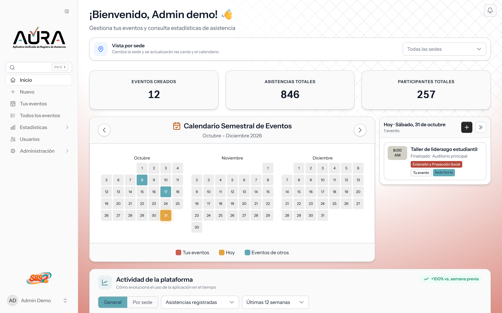
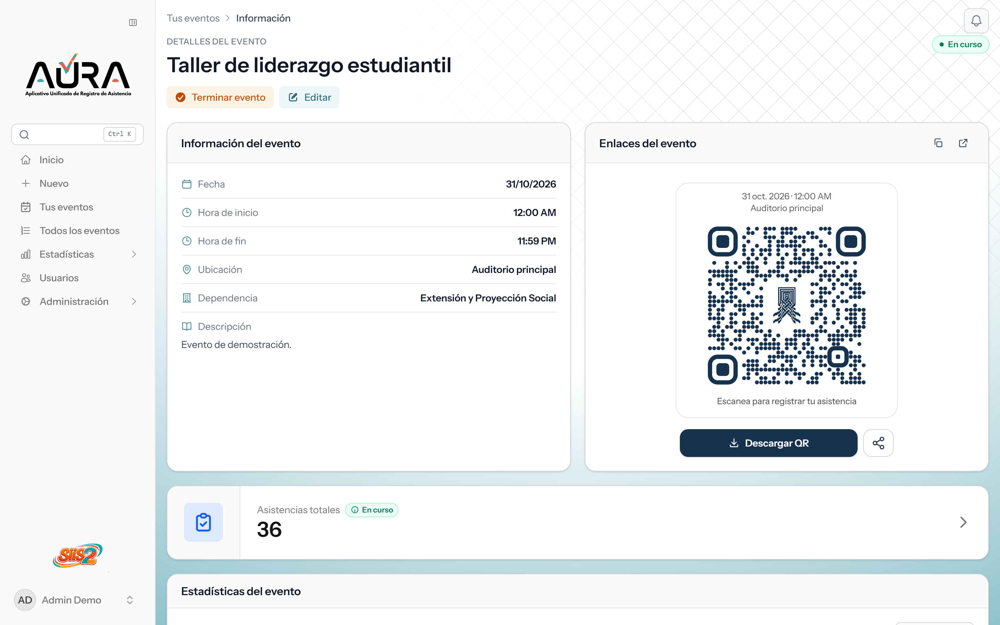
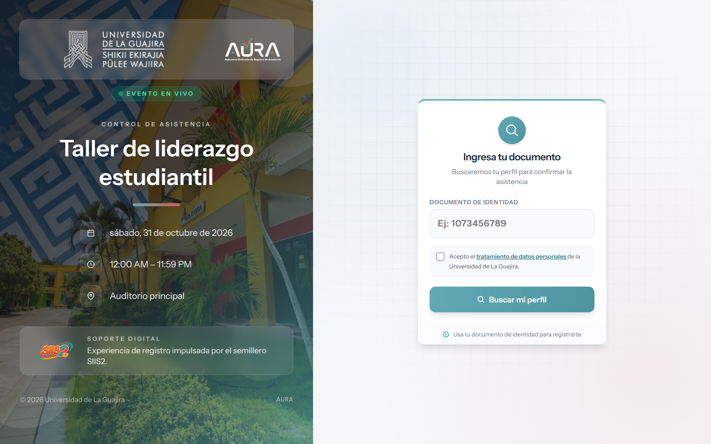
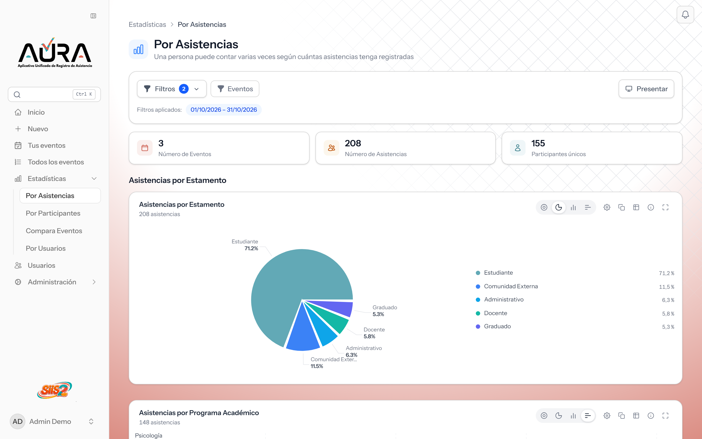

# 🎯 Aura — Control de asistencia por QR

> Sistema web para **crear eventos, registrar asistentes con código QR y obtener
> estadísticas y reportes al instante.** En uso en la **Universidad de La Guajira**.

🔗 **Demo en vivo:** [asistencia.desarrollougmaicao.com](https://asistencia.desarrollougmaicao.com)

`Laravel 12` · `Livewire` · `React (islas)` · `TypeScript` · `Tailwind 4` · `MySQL` · `Docker`

> **Problem:** Universities track event attendance on paper: slow counts, no traceability, reports that take days.  
> **Solution:** Aura registers attendees by QR code and gives organizers live statistics and instant PDF attendance reports.  
> **Stack:** Laravel 12, Livewire, React (islands) + Recharts, Tailwind 4, MySQL, Docker.  
> **Live demo:** [asistencia.desarrollougmaicao.com](https://asistencia.desarrollougmaicao.com)  
> **My role:** Full-stack developer on a team project. I worked across the whole product (backend, UI, statistics, QR registration flow, data-consent compliance, tests) rather than owning a single module.

*Capturas tomadas de una base de demostración con eventos y personas ficticios; no hay datos reales de la universidad.*

---

## El problema
Las universidades registran la asistencia a eventos (charlas, talleres, actos) de forma
manual: listas en papel, conteos a mano, cero trazabilidad y reportes que tardan días.
No hay evidencia confiable ni estadísticas para tomar decisiones.

## La solución
Aura digitaliza todo el flujo, con evidencia y estadísticas en tiempo real:

- **📅 Gestión de eventos** — creación, cierre y administración de eventos por sede, con calendario.
- **📲 Registro por QR** — el asistente escanea un código, escribe su documento y confirma; sin
  filas ni papel. Captura datos demográficos (programa, tipo de participante, dependencia).
- **📊 Estadísticas en vivo** — asistencias, participantes y eventos, con gráficas
  interactivas y comparación entre eventos.
- **📄 Reportes en PDF** — actas de asistencia generadas al instante.
- **🏢 Multi-sede** — aislamiento de datos por sede desde la arquitectura.
- **📥 Importación masiva** — carga asíncrona de participantes con revisión previa.
- **🔔 Notificaciones** in-app y por correo · **🛡️ Roles y permisos** (usuario, administrador y superadministrador).

## Capturas

| | |
|---|---|
|  |  |
| *El evento genera su QR para descargar y compartir.* | *El asistente se registra con su documento y acepta el tratamiento de datos.* |

*Estadísticas: asistencias por estamento y por programa académico, con filtros por fecha y por evento.*

## Decisiones técnicas destacadas
- **Arquitectura multi-sede** con aislamiento de datos por *scope* (un servicio central
  garantiza que cada sede solo ve lo suyo).
- **Islas de React sobre Laravel** — el backend sirve HTML rápido (bueno para carga y SEO)
  y las secciones interactivas (estadísticas) montan componentes React puntuales con Recharts.
- **PDF con mapeo de coordenadas** — las actas se rellenan sobre plantillas oficiales.
- **Cumplimiento de datos (Ley 1581)** — consentimiento persistido (fecha, IP, versión de
  la política) en el registro por QR, ya que se manejan datos de personas.
- **Importación en dos pasos** — la carga masiva guarda primero en una tabla intermedia y se revisa
  antes de confirmar, para no ensuciar la base con filas erróneas.
- **Suite de pruebas amplia** — 99 archivos de pruebas, incluidas pruebas de rendimiento de las
  páginas y de las estadísticas.
- **Instrucciones por carpeta para el trabajo con IA** — convenciones escritas (`CLAUDE.md`) por
  módulo, para que cada cambio respete el estilo del código existente.

## Números del repositorio
159 archivos PHP en `app/` · 99 archivos de pruebas, con pruebas de rendimiento. Desarrollado entre agosto de 2025 y octubre de 2026.

## Resultados
Usado en eventos reales de la Universidad de La Guajira — cientos de asistentes registrados
por QR, con **~96 % de registro digital** y reportes generados en el momento.

## Mi rol
Desarrollador full-stack en un proyecto en equipo. Trabajé en todas las capas del producto, sin
encasillarme en un módulo: backend en Laravel, interfaz, estadísticas (React y Recharts), flujo de
registro por QR, consentimiento de tratamiento de datos (Ley 1581), pruebas y decisiones documentadas.

---

> 🔒 **Código fuente privado** (es un producto en uso). Disponible para revisión en una
> entrevista técnica o bajo pedido. Este repositorio es el *case study*; el demo en vivo está
> arriba.

**Contacto:** [GitHub](https://github.com/KevinHGitCode) · kevinhafiddiazgarcia@gmail.com
