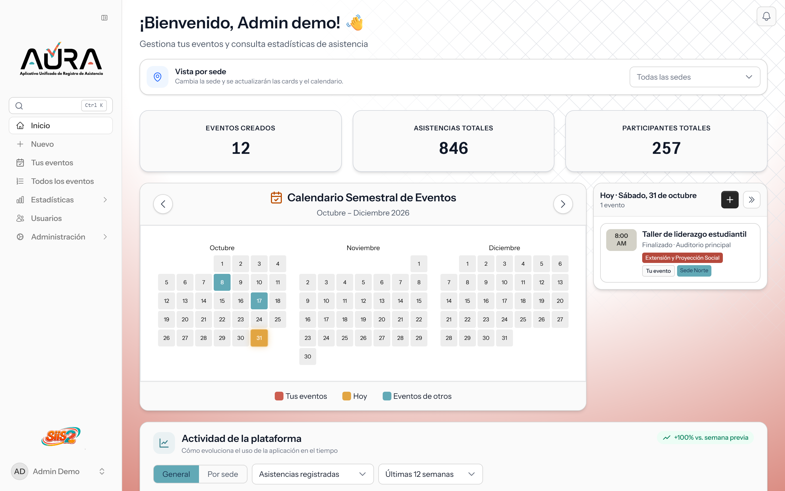
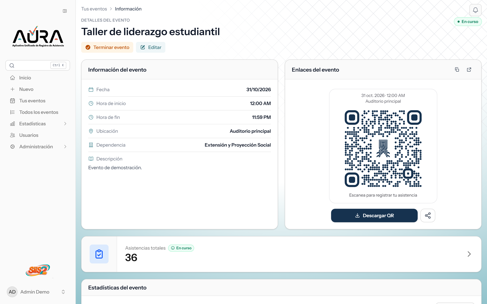
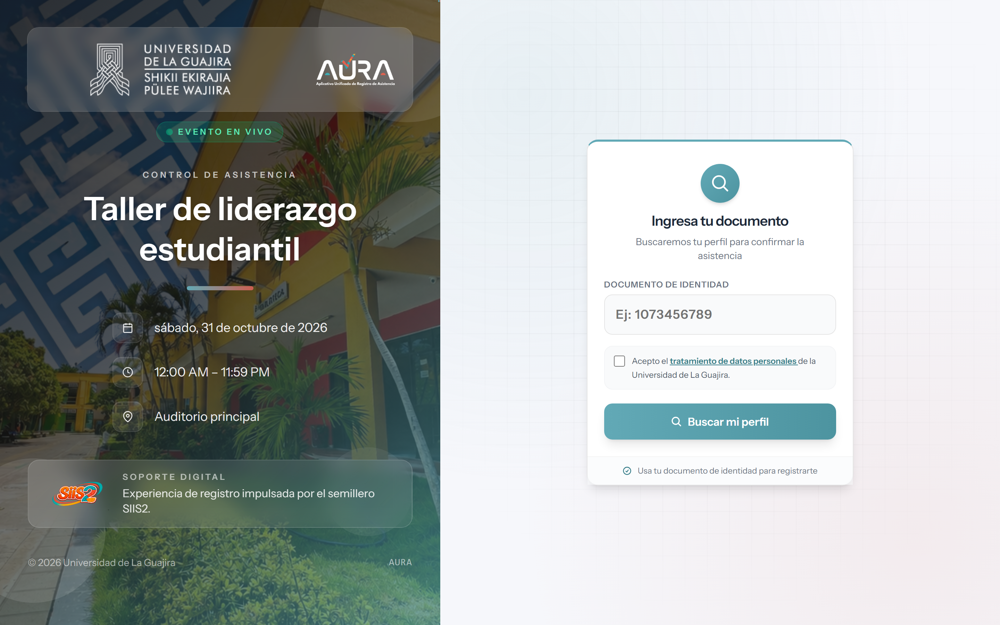
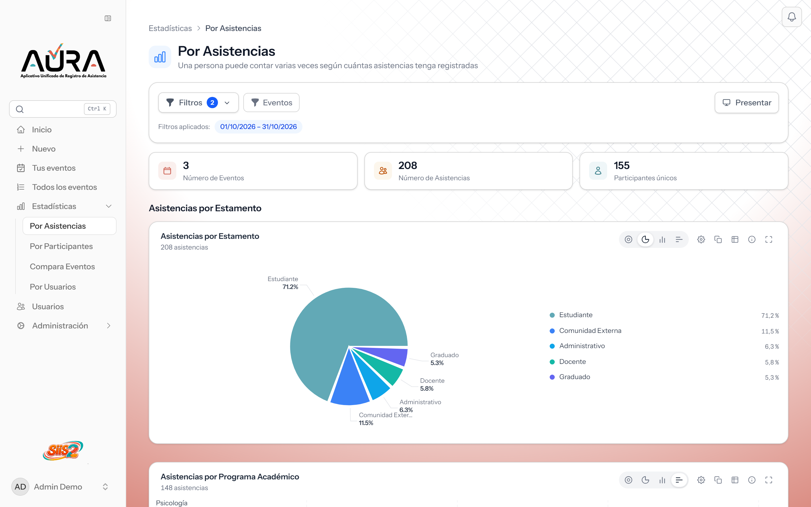

# 🎯 Aura — QR attendance control

🇬🇧 English · 🇪🇸 [Español](README.es.md)

> A web system to **create events, check attendees in with a QR code and get statistics and reports instantly.**
> In use at **Universidad de La Guajira**.

🔗 **Live demo:** [asistencia.desarrollougmaicao.com](https://asistencia.desarrollougmaicao.com)

`Laravel 12` · `Livewire` · `React (islands)` · `TypeScript` · `Tailwind 4` · `MySQL` · `Docker`

> **Problem:** Universities track event attendance on paper: slow counts, no traceability, reports that take days.
> **Solution:** Aura registers attendees by QR code and gives organizers live statistics and instant PDF attendance reports.
> **Stack:** Laravel 12, Livewire, React (islands) + Recharts, Tailwind 4, MySQL, Docker.
> **Live demo:** [asistencia.desarrollougmaicao.com](https://asistencia.desarrollougmaicao.com)
> **My role:** Full-stack developer on a team project. I worked across the whole product (backend, UI, statistics, QR registration flow, data-consent compliance, tests) rather than owning a single module.

*Screenshots come from a demo database with fictional events and people; there is no real university data.*

---

## The problem
Universities record attendance at events (talks, workshops, ceremonies) by hand: paper lists, manual
counts, no traceability, and reports that take days. There is no reliable evidence or statistics to
base decisions on.

## The solution
Aura digitizes the whole flow, with evidence and real-time statistics:

- **📅 Event management** — create, close and manage events by campus, with a calendar.
- **📲 QR check-in** — the attendee scans a code, types their ID number and confirms; no queues, no paper.
  It captures demographic data (program, participant type, department).
- **📊 Live statistics** — attendance, participants and events, with interactive charts and
  comparison between events.
- **📄 PDF reports** — attendance records generated instantly.
- **🏢 Multi-campus** — data isolation per campus built into the architecture.
- **📥 Bulk import** — asynchronous participant upload with a review step.
- **🔔 Notifications** in-app and by email · **🛡️ Roles and permissions** (user, admin and super admin).

## Screenshots

| | |
|---|---|
|  |  |
| *Each event generates its own QR to download and share.* | *The attendee checks in with their ID number and accepts the data-processing terms.* |

*Statistics: attendance by participant type and by academic program, with filters by date and by event.*

## Key technical decisions
- **Multi-campus architecture** with data isolation by scope (a central service guarantees that each
  campus only sees its own data).
- **React islands on Laravel** — the backend serves fast HTML (good for load time and SEO) and the
  interactive sections (statistics) mount specific React components with Recharts.
- **PDF coordinate mapping** — attendance records are filled in on official templates.
- **Data compliance (Colombian Law 1581)** — consent stored (date, IP, policy version) at QR
  check-in, since personal data is handled.
- **Two-step import** — bulk uploads go to a staging table first and are reviewed before they are
  confirmed, so bad rows never pollute the database.
- **Broad test suite** — 99 test files, including performance tests for the pages and the statistics.
- **Per-folder instructions for AI-assisted work** — written conventions (`CLAUDE.md`) per module,
  so every change respects the style of the existing code.

## Repository numbers
159 PHP files in `app/` · 99 test files, including performance tests. Built between August 2025 and
October 2026.

## Results
Used at real events at Universidad de La Guajira — hundreds of attendees checked in by QR, with
**~96% digital check-in** and reports generated on the spot.

## My role
Full-stack developer on a team project, alongside Daniel Sierra ([LinkedIn](https://www.linkedin.com/in/daniel-sierra-44262a3b6)) and other members of the research group. I worked across every layer of the product
rather than owning a single module: Laravel backend, UI, statistics (React and Recharts), the QR
check-in flow, data-processing consent (Law 1581), tests and documented decisions.

---

> 🔒 **Source code is private** (it is a product in use). Available for review in a technical
> interview or on request. This repository is the case study; the live demo is above.

**Contact:** [GitHub](https://github.com/KevinHGitCode) · [LinkedIn](https://www.linkedin.com/in/kevin-diaz-garcia-846999240/) · [Instagram](https://www.instagram.com/kevin.hdiaz/) · kevinhafiddiazgarcia@gmail.com

© 2026 Kevin Díaz. All rights reserved. Text and screenshots may not be reused without permission. University and SIIS2 logos belong to their respective owners.
